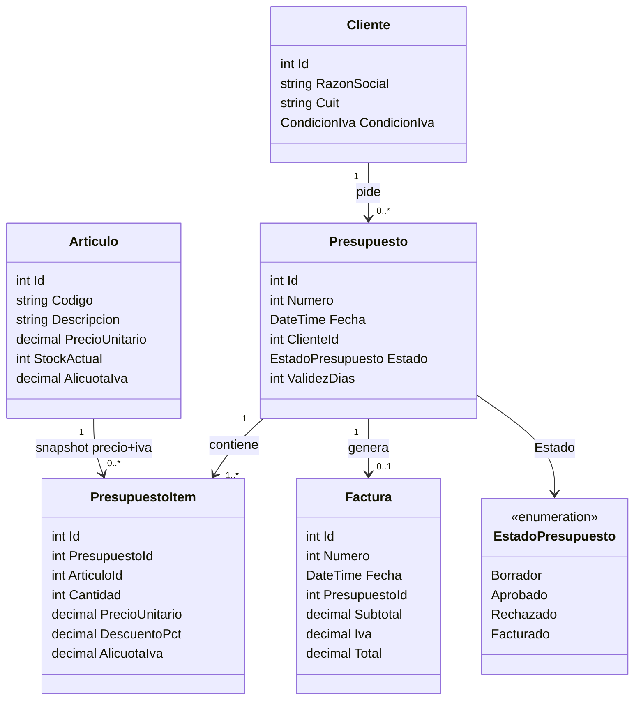
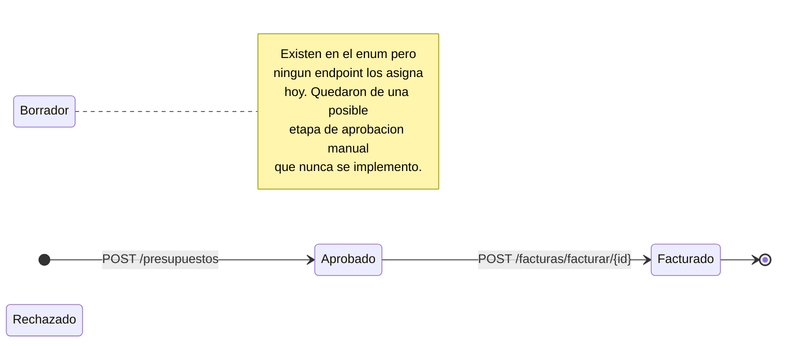

# Modelo de dominio — Mini ERP (backend)

> Diagrama de clases y ciclo de vida del `Presupuesto` tal como quedaron tras corregir
> los bugs de la Parte A (ver `NOTES.md` para el detalle de cada fix). Referencia rápida
> antes de construir el cliente React.

## Entidades y relaciones

**Dato clave:** `PresupuestoItem.PrecioUnitario` y `AlicuotaIva` son una **copia** tomada
en `PresupuestoService.CrearAsync`, no una referencia viva al `Articulo`. Si el precio de
catálogo cambia después, el presupuesto ya emitido no se mueve — es la base para
"Duplicar presupuesto" (Parte C): ahí sí hay que refrescar el precio a propósito.

**Límite conocido:** la relación `Presupuesto → Factura` es 1:0..1 por regla de negocio
(idempotencia), pero hoy se garantiza sólo a nivel de servicio (`FacturacionService`
chequea `Estado == Facturado`), no con una constraint de base de datos. Bajo concurrencia
real, dos requests simultáneos podrían pasar el chequeo antes de que el primero confirme.
Pendiente para producción.

## Ciclo de vida de un Presupuesto

Este fue uno de los bugs encontrados: todo presupuesto se creaba en `Borrador`, pero el
listado filtraba `Estado != Borrador` — así que nada de lo que se creaba era visible
nunca en la grilla. Como no existe ningún endpoint que mueva algo de `Borrador` a
`Aprobado`, la corrección fue crear directamente en `Aprobado`.

`Borrador` y `Rechazado` son estados muertos: existen en el enum pero ningún endpoint
los asigna actualmente.

## Dónde vive cada regla de negocio

| Regla | Dónde se aplica |
|---|---|
| IVA por línea, redondeado antes de sumar | `PresupuestoService.CalcularTotales` |
| Stock nunca negativo al facturar | `FacturacionService.FacturarAsync` |
| Un presupuesto se factura una sola vez | `FacturacionService.FacturarAsync` (chequeo de `Estado`) |
| Presupuesto vencido no se factura | `FacturacionService.FacturarAsync` (`Fecha + ValidezDias`) |
| Numeración secuencial sin colisiones | `NumeracionService` (`MAX(Numero)+1`) |
| Cantidad y descuento válidos | `CrearPresupuestoItemDto` (`DataAnnotations`) |
