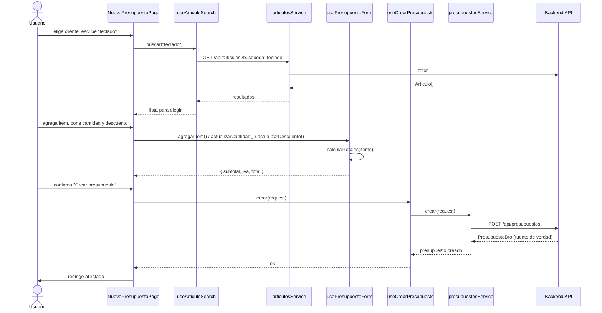
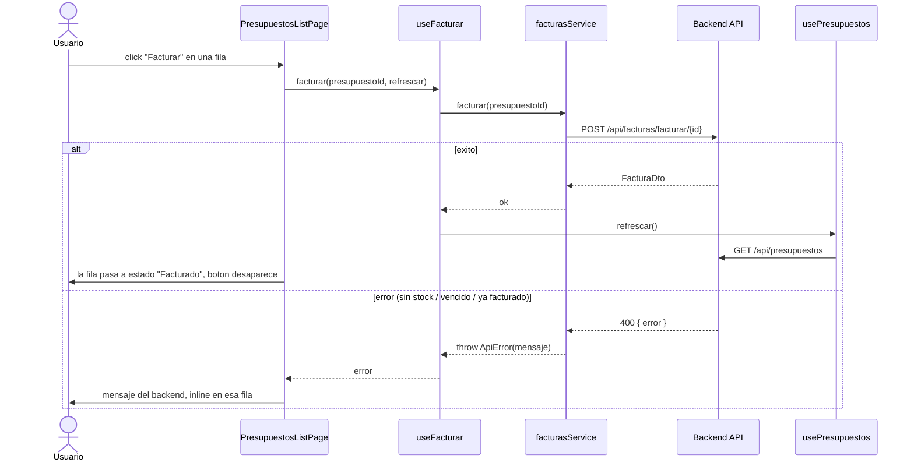
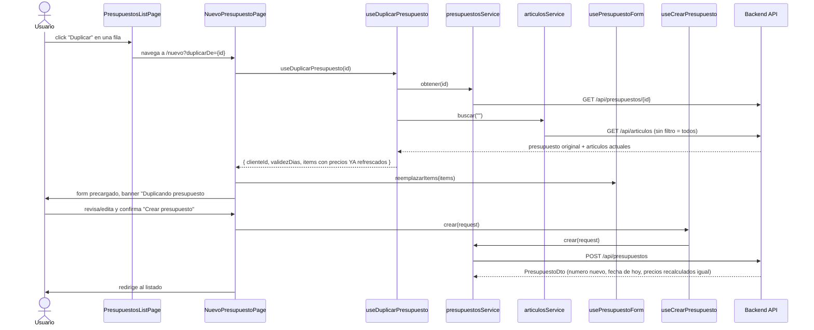

# Arquitectura del cliente — Mini ERP (frontend)

> Capas, dependencias entre ellas y los flujos principales (alta de presupuesto,
> facturar, duplicar, reporte de top artículos), tal como quedaron implementados
> en `frontend/src/`. Ver `NOTES.md` para las decisiones de producto; este
> documento es el mapa técnico.

## Organización

`pages` orquesta; `components` sólo pinta lo que le pasan por props; `hooks` es donde
vive el estado y las reglas (incluida la réplica del cálculo de totales); `services`
es la única capa que sabe que existe `fetch` y una URL base. Nada corre en sentido
contrario — un `component` nunca importa un `service`.

```
frontend/src/
├─ pages/
│  ├─ PresupuestosListPage.tsx      # grilla + accion "Facturar"
│  ├─ NuevoPresupuestoPage.tsx      # alta/duplicar: cliente + items + totales en vivo
│  └─ ReportePage.tsx               # filtro de fechas + top N -> tabla
├─ components/
│  ├─ PresupuestosTable.tsx
│  ├─ EstadoBadge.tsx
│  ├─ ClienteSelect.tsx
│  ├─ ArticuloSearchBox.tsx
│  ├─ PresupuestoItemsEditor.tsx
│  ├─ TotalesSummary.tsx
│  ├─ TopArticulosTable.tsx
│  └─ ErrorAlert.tsx
├─ hooks/
│  ├─ usePresupuestos.ts            # listar + eliminar + refrescar
│  ├─ useCrearPresupuesto.ts        # POST crear, aislado para no refetchear la grilla
│  ├─ useFacturar.ts                # POST facturar + error por presupuesto
│  ├─ useClientes.ts
│  ├─ useArticuloSearch.ts          # busqueda con debounce
│  ├─ usePresupuestoForm.ts         # items del borrador + calcularTotales()
│  ├─ useDuplicarPresupuesto.ts     # precarga el form desde un presupuesto existente
│  └─ useTopArticulos.ts            # dispara la consulta del reporte a pedido
├─ services/
│  ├─ http.ts                       # fetch wrapper + ApiError
│  ├─ clientesService.ts
│  ├─ articulosService.ts
│  ├─ presupuestosService.ts
│  ├─ facturasService.ts
│  └─ reportesService.ts
├─ types/
│  └─ dtos.ts                       # espejo de MiniErp.Api.Dtos + ItemBorrador
├─ App.tsx                          # rutas: "/", "/nuevo" y "/reporte"
└─ main.tsx
```

| Capa | Responsabilidad | Puede importar | No debe importar |
|---|---|---|---|
| `pages` | Orquesta hooks + components para una ruta | components, hooks, types | services (directo) |
| `components` | Presentación pura, recibe todo por props | types | hooks, services |
| `hooks` | Estado, efectos, reglas de negocio del cliente | services, types | components |
| `services` | Único punto que habla HTTP con la API | types | hooks, components |

> **Ajuste sobre la propuesta inicial:** en el diagrama que revisamos antes de
> implementar, un solo hook (`usePresupuestos`) cubría listar/crear/eliminar. En la
> implementación lo separé en `usePresupuestos` (listar + eliminar, usado por la
> grilla) y `useCrearPresupuesto` (crear, usado por el alta) para que la página de
> alta no dispare un `GET /api/presupuestos` innecesario al montarse — no tiene
> sentido traer la lista completa en una pantalla que sólo va a crear un registro.

## Diagrama de dependencias

```mermaid
flowchart TB
    subgraph PAGES["pages/"]
        P1["PresupuestosListPage"]
        P2["NuevoPresupuestoPage"]
        P3["ReportePage"]
    end
    subgraph COMPONENTS["components/ (presentacionales)"]
        C1["PresupuestosTable"]
        C2["EstadoBadge"]
        C3["ClienteSelect"]
        C4["ArticuloSearchBox"]
        C5["PresupuestoItemsEditor"]
        C6["TotalesSummary"]
        C7["ErrorAlert"]
        C8["TopArticulosTable"]
    end
    subgraph HOOKS["hooks/"]
        H1["usePresupuestos"]
        H2["useFacturar"]
        H3["useClientes"]
        H4["useArticuloSearch"]
        H5["usePresupuestoForm"]
        H6["useCrearPresupuesto"]
        H7["useDuplicarPresupuesto"]
        H8["useTopArticulos"]
    end
    subgraph SERVICES["services/"]
        S1["presupuestosService"]
        S2["facturasService"]
        S3["clientesService"]
        S4["articulosService"]
        S5["http"]
        S6["reportesService"]
    end

    P1 --> C1
    P1 --> C2
    P1 --> C7
    P1 --> H1
    P1 --> H2

    P2 --> C3
    P2 --> C4
    P2 --> C5
    P2 --> C6
    P2 --> C7
    P2 --> H3
    P2 --> H4
    P2 --> H5
    P2 --> H6
    P2 --> H7

    P3 --> C7
    P3 --> C8
    P3 --> H8

    H1 --> S1
    H2 --> S2
    H3 --> S3
    H4 --> S4
    H6 --> S1
    H7 --> S1
    H7 --> S4
    H8 --> S6

    S1 --> S5
    S6 --> S5
    S2 --> S5
    S3 --> S5
    S4 --> S5
```



Las flechas van siempre hacia abajo: `pages → components/hooks → services`. Nunca al
revés. `usePresupuestoForm` (H5) no llama a ningún service — es puro estado +
cálculo (`calcularTotales`), no hace fetch.

## Flujo 1 — Alta de presupuesto, con totales en vivo

`usePresupuestoForm` calcula subtotal/IVA/total con la **misma** regla que
`PresupuestoService.CalcularTotales` en el backend (IVA por línea, redondeado a 2
decimales, recién después se suma). Verificado contra el flujo de IVA mezclado del
README (ART-001 + ART-004): da subtotal 39.500, IVA 7.822,50, total 47.322,50, igual
que el backend.



El backend siempre tiene la última palabra: lo que calcula `Form` es sólo preview;
lo que queda persistido es la respuesta de `POST /api/presupuestos`.

## Flujo 2 — Facturar desde la grilla

Los tres rechazos posibles (sin stock, vencido, ya facturado) vuelven como
`400 { error }` desde el mismo endpoint. El hook no distingue el caso — muestra
directo el mensaje que mandó el backend, en la fila correspondiente.



Probado en el browser contra el backend real: ART-006 (stock 3) con cantidad 10
devuelve "Stock insuficiente para el artículo ART-006" en la fila; facturar dos
veces el mismo presupuesto no es posible desde la UI porque el botón "Facturar"
desaparece apenas el estado pasa a `Facturado`.

## Flujo 3 — Duplicar presupuesto (sin tocar el backend)

El insight que hace posible esto sin ningún endpoint nuevo: `POST /api/presupuestos`
ya refresca precio y alícuota **actuales** del artículo al crear (no confía en lo que
mande el cliente) y asigna número/fecha nuevos solo. "Clonar con número nuevo, fecha
de hoy y precios refrescados" es exactamente lo que ya hace ese endpoint.



El `GET /api/articulos` sin filtro sólo existe para que el *preview* de totales en el
form ya se vea con precios actuales antes de confirmar — el refresco real, el que
queda persistido, lo vuelve a hacer el backend en `CrearAsync` sin importar lo que
mande el cliente. Si el artículo original ya no existe en el catálogo (no hay endpoint
para borrar artículos hoy, así que no debería pasar), se cae al snapshot guardado en
el item original como fallback.

## Decisiones

- **Components tontos:** ningún componente en `components/` llama a un hook de
  datos ni a un service. Todo entra por props. (La excepción visual es el `Link`
  de "Duplicar" en `PresupuestosTable` — es navegación, no fetch de datos; no
  rompe la regla.)
- **Un solo fetch wrapper:** `services/http.ts` centraliza la URL base y el mapeo
  de una respuesta no-2xx a un `ApiError` con el mensaje que manda el backend.
- **Sin librería de estado global:** no sumé Redux/Zustand/React Query — tres
  páginas y ocho hooks no lo justifican. Si el proyecto creciera, lo primero que
  metería es React Query antes que estado global a mano.
- **Duplicar reutiliza todo:** ni un service ni un endpoint nuevo del lado del
  backend. `useDuplicarPresupuesto` combina dos llamadas ya existentes
  (`presupuestosService.obtener` + `articulosService.buscar("")`) y el resto es
  el mismo formulario de alta con los datos precargados.
- **Reporte sin auto-fetch:** `useTopArticulos` no trae nada al montar — no hay
  un rango de fechas por defecto razonable sin que el usuario lo pida. Expone
  un `buscar(desde, hasta, top)` que `ReportePage` dispara al enviar el form
  (con un default sensato precargado: primer día del mes actual hasta hoy).

## Tipos (`types/dtos.ts`)

Espejo de `MiniErp.Api.Dtos`, más un tipo exclusivo del cliente para la línea que se
está armando en el formulario (todavía no tiene `Id` ni fue persistida).

| Tipo TS | Origen | Usado por |
|---|---|---|
| `Cliente` | espejo de `ClienteDto` | `useClientes`, `ClienteSelect` |
| `Articulo` | espejo de `ArticuloDto` | `useArticuloSearch`, `ArticuloSearchBox` |
| `Presupuesto` | espejo de `PresupuestoDto` | `usePresupuestos`, `PresupuestosTable` |
| `PresupuestoItemDto` | espejo de `PresupuestoItemDto` (backend) | `Presupuesto.items`, `PresupuestoItemsEditor` (vía `ItemBorrador`) |
| `Factura` | espejo de `FacturaDto` | `useFacturar` |
| `ItemBorrador` | sólo frontend — `Articulo` embebido + cantidad + descuento, sin `Id` | `usePresupuestoForm`, `PresupuestoItemsEditor` |
| `TopArticulo` | espejo de `TopArticuloDto` | `useTopArticulos`, `TopArticulosTable` |
